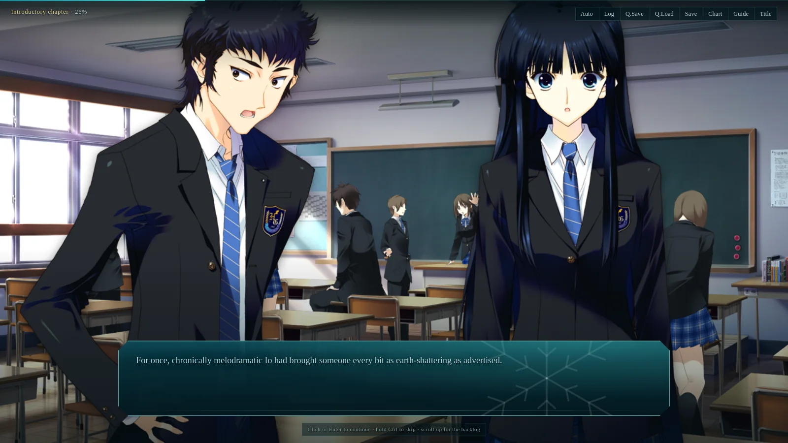

# white-album2-web

Fan-made web port of **WHITE ALBUM 2 Extended Edition** — engine + tooling
only. Game data and assets are supplied by the player; gameplay/path
parity with the PC original is the top priority.

*Early Introductory Chapter preview, captured from the author's own
legally-owned build. The repository distributes no game data or asset
files; the only game-derived visual is this promotional screenshot, which
depicts game art and translated text, is never loaded by the engine, and
is not part of any pack.*

**Engine, quickstart, verification:** see
[`wa2-web/README.md`](wa2-web/README.md) and [`wa2-web/docs/`](wa2-web/docs/).
Third-party translation notices: [`THIRD_PARTY_NOTICES.md`](THIRD_PARTY_NOTICES.md).
The original engine/tooling code is MIT-licensed ([`LICENSE`](LICENSE));
game assets and the translation are not covered.

**Fastest local play:** `cd wa2-web && ./play.sh --game-dir /path/to/game`
(or `--image disc1.iso ...`); it extracts, builds, and serves the web app.
See [`wa2-web/docs/ONECLICK.md`](wa2-web/docs/ONECLICK.md).

## Demo and external packs

Building `wa2-web/web` without local game data or assets boots an
**asset-free engine demo** using original placeholder prose and an
original CSS winter scene. It demonstrates the reader, choices, backlog,
flowchart, guide, saves, and settings without redistributing any game
content.

An independently hosted pack is configured at build time via
`VITE_PACK_URL=https://your-host.example/wa2-pack` (or overridden at
runtime with `?pack=...`; the pack root must contain `data/` and
`assets/manifest.json` and allow CORS). See
[`wa2-web/docs/BYOA.md`](wa2-web/docs/BYOA.md) and
[`wa2-web/docs/LEGAL.md`](wa2-web/docs/LEGAL.md).

## Source build

The reference install this port is built and tested against is the
Extended Edition + tokuten disc image.

## Translation

English scenario data comes from the
[MAO-TLs WHITE ALBUM 2 v2.1.0](https://github.com/MAO-TLs/white-album-2)
release (used as build input via `tools/build.py --mao` / `fetch_mao.py`
drift pin — never redistributed here).

## Status

Experimental. Voices, BGM/SE, backdrops, event art, sprites, LUT color
grades, flowchart/guide/saves work. Native PC `save_XX.sav` / `save_Q.sav`
files import in Save/Load (script + line/choice mapping); `Sys.sav` global
read/choice flags are recognized but not mapped yet. Full gate matrix and
open parity items: `wa2-web/docs/QA.md`; self-packaging and size tiers:
`wa2-web/docs/PACKAGING.md`.

## Hosting

I am currently not hosting a public full pack in this repository; hosting
is treated independently from the engine/tooling source.
If you want to discuss hosting, write to naczo5@proton.me.

