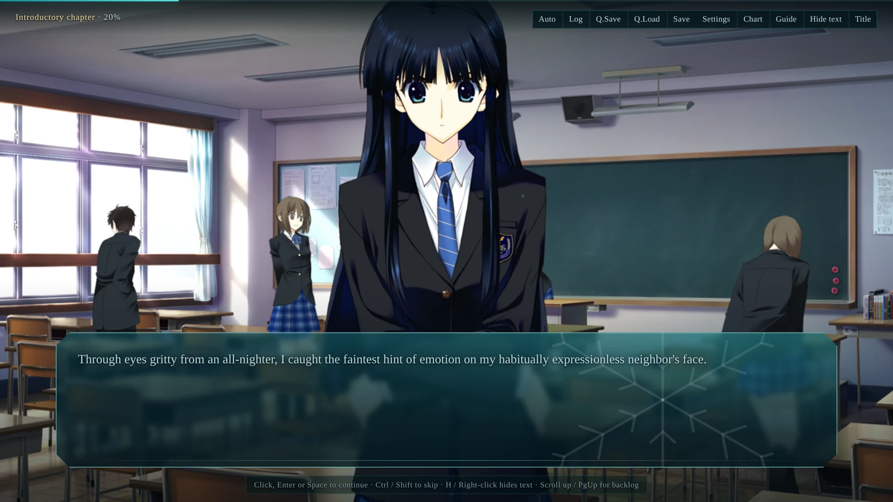

# white-album2-web

[](LICENSE)

A fan-made browser engine and asset pipeline for **WHITE ALBUM 2 Extended Edition**.

No game files or translations are included in this repository. You supply your own copy of the game (built and tested against the Extended Edition + tokuten disc) and build the playable files locally.



*Screenshot from the author's own copy. Not loaded by the engine or included in packs.*

## Quickstart

```sh
cd wa2-web
./play.sh --game-dir /path/to/game
# or from disc images:
./play.sh --image disc1.iso --image disc2.iso --i-own-the-game
```

This extracts assets, builds the scenario data, and starts a local web server. See [ONECLICK.md](wa2-web/docs/ONECLICK.md) for options, or [wa2-web/README.md](wa2-web/README.md) for the manual pipeline.

Without game files, building `wa2-web/web` boots an asset-free demo with placeholder text and a CSS background. To load an independently hosted pack instead, set `VITE_PACK_URL` at build time or pass `?pack=<url>` at runtime (see [BYOA.md](wa2-web/docs/BYOA.md)).

## Features

Experimental, focused on gameplay and route parity with the PC release:

- Full reader: voices, intro/loop BGM, SE, CGs, sprites, `.AMP` color LUTs, weather/shake/calendar overlays, NovelMode, EroMode voice filter, and optional timed captions.
- Interactive flowchart with calendar dates, spoiler-hidden mode, and walkthrough guide.
- Switchable English translations (saves stay compatible across both).
- Native PC save import (`save_XX.sav`, `save_Q.sav`, and `Sys.sav` global unlocks/progress), plus browser slots, quick save/load, and JSON export/import.
- Extras: CG gallery, music player, and 24-scene replay.
- Portable static builds via `tools/pack_site.py` (see [PACKAGING.md](wa2-web/docs/PACKAGING.md)).

Known gaps and test status are tracked in [QA.md](wa2-web/docs/QA.md).

## Translations

You pick a translation on first launch and can switch anytime in Settings without losing saves:

- [MAO-TLs](https://github.com/MAO-TLs/white-album-2) (AI translation, built via `tools/build.py --mao`)
- [TodokanaiTL](https://github.com/TodokanaiTL/WA2EnglishPatch) (human translation, built via `tools/build.py --alt`)

See [BYOA.md](wa2-web/docs/BYOA.md) for setup and [THIRD_PARTY_NOTICES.md](THIRD_PARTY_NOTICES.md) for full credits.

## Smoke test

To verify the demo UI end-to-end in headless Chromium:

```sh
cd wa2-web/web && npm install && npm run smoke
```

Use `WA2_CHROME` to point to a custom browser binary or `WA2_SMOKE_URL` to test an already-running server.

## Credits & License

Engine and tooling code is MIT-licensed ([LICENSE](LICENSE)). Game assets and translations are not covered; see [LEGAL.md](wa2-web/docs/LEGAL.md) and [THIRD_PARTY_NOTICES.md](THIRD_PARTY_NOTICES.md).

[galhack/WhiteAlbum2_iOS](https://github.com/galhack/WhiteAlbum2_iOS) ([Apache-2.0](LICENSES/Apache-2.0.txt)) was used as a reference and cross-validation source for save formats, LSCR semantics, and visual behavior. The 33-entry CK-GAL glyph map and 24-row scene-replay table are reproduced from it; the rest of the engine is an independent implementation.
