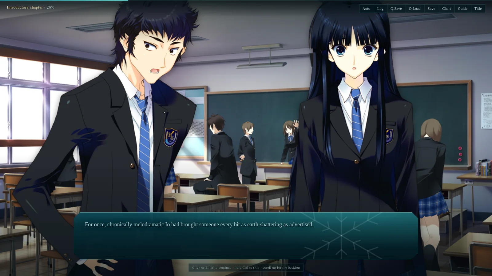

# wa2-web — WHITE ALBUM 2 Extended Edition, web port (BYOA)

A fan-made web engine + QoL shell (flowchart, guide, file saves) for
WHITE ALBUM 2 Extended Edition. Gameplay and path parity is the top
priority; everything structural comes from the game's own scenario data.

**Bring your own assets.** This repository distributes no game data or
asset files: no scenario text files, playable images, audio, movies, or
translation. (The README preview is a single promotional screenshot, not a
runtime asset.) You supply a legally-owned Japanese copy plus the MAO-TLs
v2.1.0 English release; `tools/build.py` turns them into playable web data
on your machine. See `docs/BYOA.md`.



*Early preview captured from the author's own legally-owned build. The
repository distributes no game data or asset files; this promotional
screenshot is the only game-derived visual, is never loaded by the engine,
and is not part of any pack.*

## Demo and external packs

The frontend is a static Vite app. Built without `data/` or `assets/`,
it boots an asset-free engine demo using original placeholder prose and a
CSS winter scene. A separately hosted BYOA pack can be loaded with
`?pack=https://your-host.example/wa2-pack` (the pack root needs `data/`
and `assets/manifest.json` with CORS enabled). See
[docs/BYOA.md](docs/BYOA.md) for the pack layout.

## Layout

```
wa2-web/
  tools/      offline pipeline (KCAP extract, scenario parser, flow/links
              derivation, MAO pin + drift audit, asset converter, simulator)
  tests/      pytest suite (unit + BYOA corpus conformance, env-gated)
  data/       hand-authored sources: endings, terminals, annotation RULES
              (annotate_flow.py); generated flow.json/links.json are
              reproducible build outputs kept in sync by tools/build.py
  web/        Vite+TypeScript player (engine + title/flowchart/guide/saves)
  docs/       ARCHITECTURE, BYOA, ONECLICK, PARSING, FLOW_GRAPH, QA, LEGAL
```

## One click

```sh
./play.sh --game-dir /path/to/game       # installed/extracted game
# or: ./play.sh --image disc1.iso --image disc2.iso --i-own-the-game
```

It extracts images (if needed), builds data/assets, builds the web app, and
serves it locally. See [docs/ONECLICK.md](docs/ONECLICK.md). The manual
pipeline is below.

## Quickstart (empty checkout -> playable)

```sh
# 1. scenario text (needs your en.pak files, v2.1.0)
python3 tools/build.py /path/to/en.pak /path/to/special-en.pak ./build
cp -r build/data/* web/public/data/

# 2. assets (needs your installed game dir)
python3 tools/extract_assets.py /path/to/game build/assets \
  --en-pak /path/to/en.pak --en-pak /path/to/special-en.pak
cp -r build/assets web/public/assets

# 3. play
cd web && npm install && npm run dev
```

Without steps 1-2 the player boots a tiny original demo so the UI is
testable with zero assets.

## Verification

```sh
python3 -m pytest tests/ -q                          # unit + data integrity
WA2_EN_PAK=/path/to/en.pak python3 -m pytest tests/  # + corpus parity
python3 tools/simulate.py IR FLOW LINKS TERMINALS routers
python3 tools/fetch_mao.py IR_MAIN IR_SPECIAL --clone /path/to/mao-clone
cd web && npx vitest run && npx tsc --noEmit && npm run build
# self-contained package + size report:
python3 tools/pack_site.py --build --zip
```

Current status: 77 pytest + 9 skipped (84 passed with `WA2_EN_PAK`);
88 vitest + 2 BYOA-skipped, plus the real-data shipped-Router playthrough
(183/221 scripts, no throw/stall). Native PC saves: `save_XX.sav` /
`save_Q.sav` import through the Save/Load screen (script + line/choice
buffers → engine event); `Sys.sav` global read/choice flags are recognised
but not mapped yet. Manual quick save/load and a separate autosave row are
available. Full build is green against the installed
JP game: flow 32/32, bnr choice markers 32/32, simulate clean
(153/221 routers; 68 unvisited = 19 JP variants + 49 Special-menu scripts),
links 206 sites (199 HINT + 7 SWITCH), MAO v2.1.0 drift
audit 0.988 containment over 171 scripts. Voices wired, sprites/dynamic
staging decoded from `.bnr`, movies resolve; exact `.AMP` color LUTs; BGM
loop pairs (`_A` intro + `_B` body); typewriter/auto/skip/volumes; novels +
Special menu. Music: BGM scene→track map solved statically (.bnr opcode
(4,158), 1288 plays across 242 scripts; only bonus-disc tracks 78/79
sustain). Choices cross-checked against engine (4,208) markers (32/32);
flag identities engine-evidenced (Global.vrb/GFLAG.dat). Sound effects:
(4,164) + ambient (4,165/166). Open residuals: numeric flag thresholds/
deltas, variant entry rules, special-series termination, 3016/3023
short-path confirmation. Details in `docs/QA.md`; packaging sizes/limits
in `docs/PACKAGING.md`.
